<div align="center">


# Social Media Copilot

**Planeje seus posts em vários perfis e deixe a IA ajudar com roteiros, legendas e ideias, tudo no seu computador.**

[Baixar](https://github.com/marcuth/social-media-copilot/releases) · [Primeiros passos](#-primeiros-passos) · [Funcionalidades](#-o-que-você-pode-fazer) · [Perguntas frequentes](#-perguntas-frequentes)

</div>

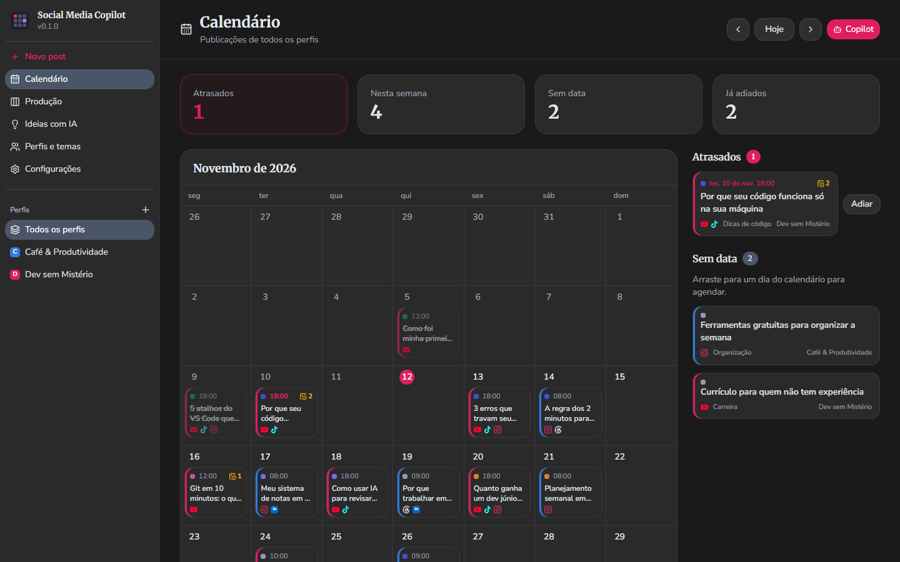

---

## 💡 O que é

O **Social Media Copilot** é um aplicativo de desktop para quem cria conteúdo para redes sociais, sozinho ou com uma equipe pequena. Ele junta duas coisas:

1. **Um calendário de publicações** para todos os seus perfis, com quadro de produção, adiamentos e histórico.
2. **Um copiloto de IA** que conhece seus perfis, a sua agenda e o post que você está editando, e ajuda a escrever roteiros, títulos, descrições, hashtags e ideias.

Você escolhe qual IA usar. Seus dados ficam no seu computador, e só o que você pede para a IA vai ao provedor escolhido.

## ✨ O que você pode fazer

### 📅 Ver tudo em um calendário

Veja o mês inteiro, arraste um post para outro dia para reagendar e acompanhe o que está **atrasado**, o que vai sair **nesta semana** e o que ainda está **sem data**.


### 🧩 Acompanhar a produção

O quadro de produção mostra cada post na sua etapa: **Ideia, Roteiro, Gravação, Edição, Pronto** e **Publicado**. Arraste os cartões conforme o trabalho avança e filtre por tema ou plataforma.

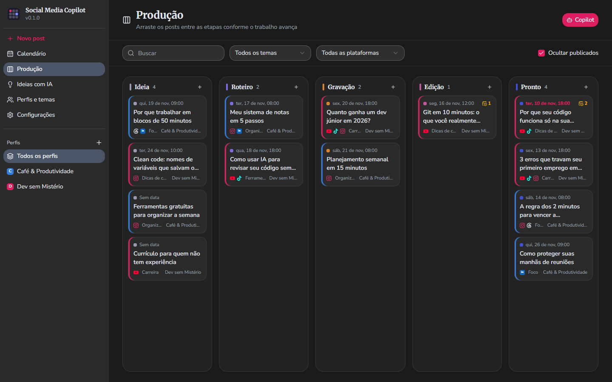

### 👥 Gerenciar vários perfis

Cada perfil é um canal ou uma marca, com as plataformas em que publica (YouTube, TikTok, Instagram, Facebook, X, Threads, LinkedIn, Pinterest e Kwai), o @ em cada uma, nicho, público e tom de voz. A IA usa essas informações para escrever como o seu perfil. Organize o conteúdo em **temas** para filtrar e dar contexto.

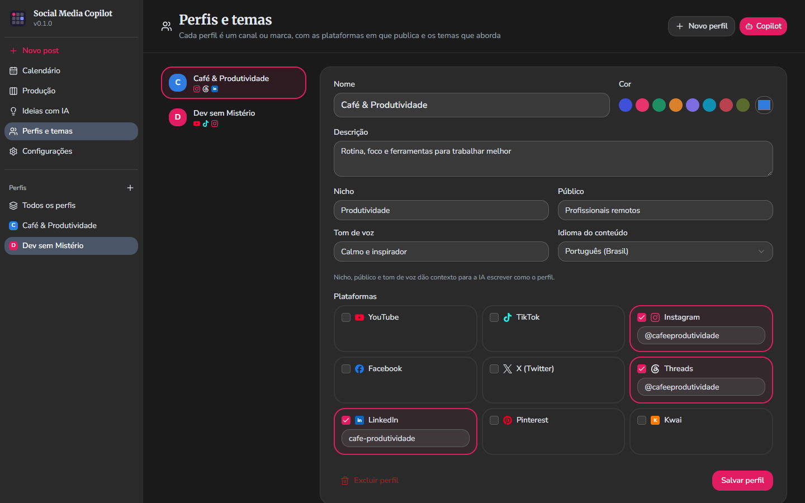

### ✍️ Escrever com ajuda da IA

No editor de cada post você preenche título, descrição, tags, hashtags e roteiro. O Copiloto:

- **Escreve o roteiro** em tempo real, com a duração e as instruções que você pedir.
- **Sugere os metadados** (título, descrição, tags e hashtags) respeitando as regras de cada plataforma.
- **Propõe ideias novas** na tela _Ideias com IA_, que entram direto na produção.
- Segue **métodos de escrita** (as _skills_) escolhidos conforme o formato e a plataforma, e você pode desligá-las quando quiser.

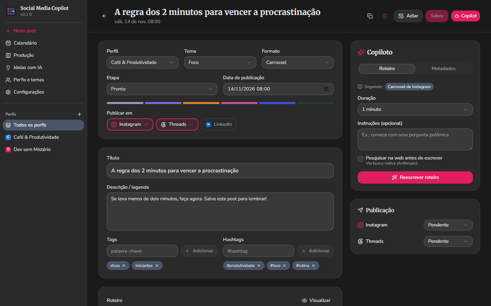

### ⏳ Adiar sem bagunçar a agenda

Escolha **+1 dia**, **+3 dias**, **+1 semana**, o **próximo dia livre** do perfil ou uma data específica. Com **empurrar a fila**, os próximos posts do perfil andam junto, mantendo o espaçamento. Todo adiamento fica registrado no histórico do post.

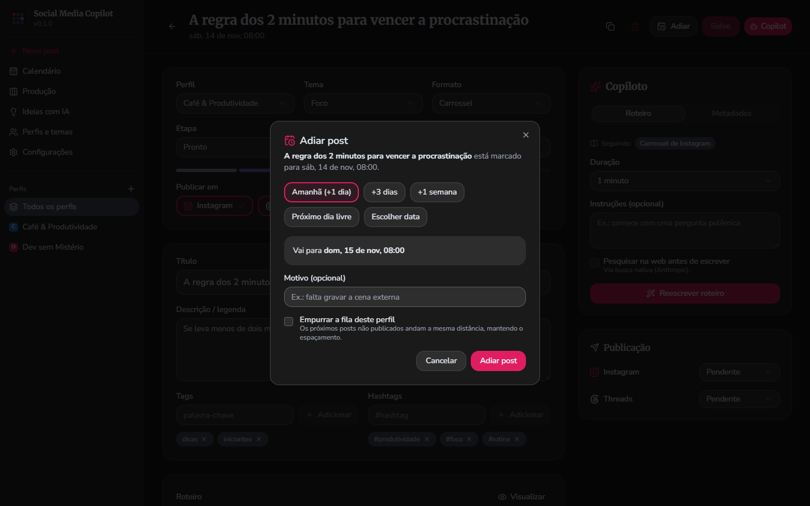

### 🤖 Conversar com o Copilot

Abra o chat em qualquer tela e pergunte o que quiser: "Como está minha agenda?", "Me dê 3 ideias para a semana", "Reescreva essa legenda". O Copiloto vê seus perfis, a agenda e o post aberto, então responde sem você precisar explicar o contexto. O painel pode ser expandido para tela cheia, e as conversas ficam salvas.

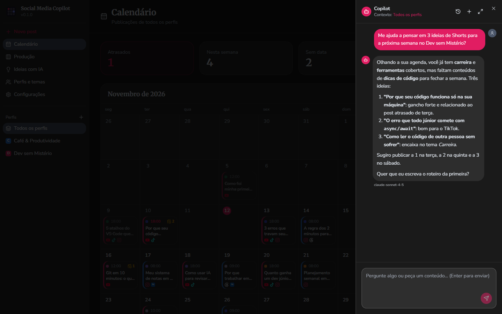

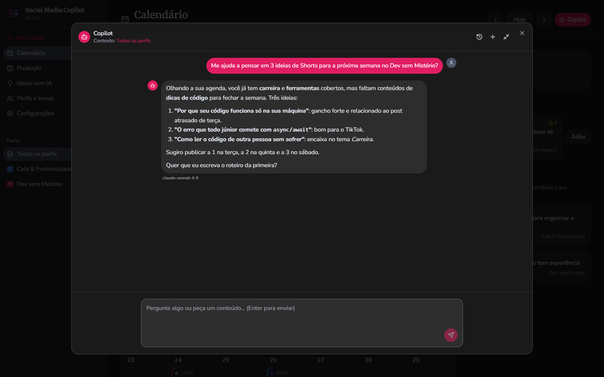

### 🌐 Pesquisar na web

O Copiloto pesquisa fatos atuais e lê links no chat, e pode pesquisar antes de escrever roteiros e ideias. Usa a busca do próprio provedor quando ela existe (Anthropic, Google e OpenAI) e o [Firecrawl](https://www.firecrawl.dev) nos demais, inclusive com modelos locais.

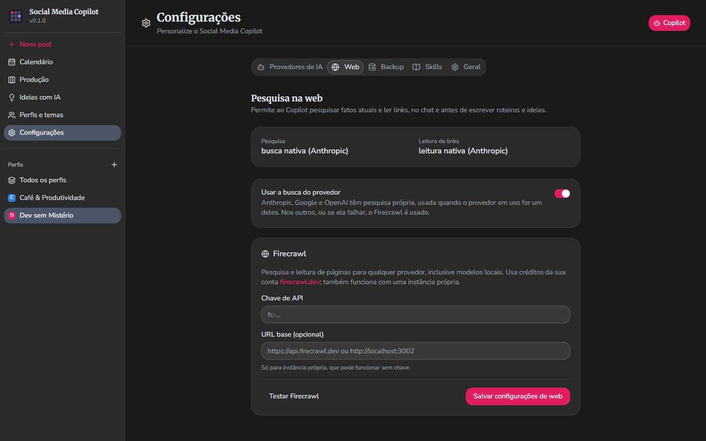

### 🔌 Use a IA que você preferir

Funciona com **OpenAI, Anthropic, Google Gemini, DeepSeek, Groq, OpenRouter, LM Studio, Ollama** ou qualquer API compatível com a da OpenAI. Cadastre vários provedores e troque quando quiser. Com um modelo local, nada sai do seu computador.

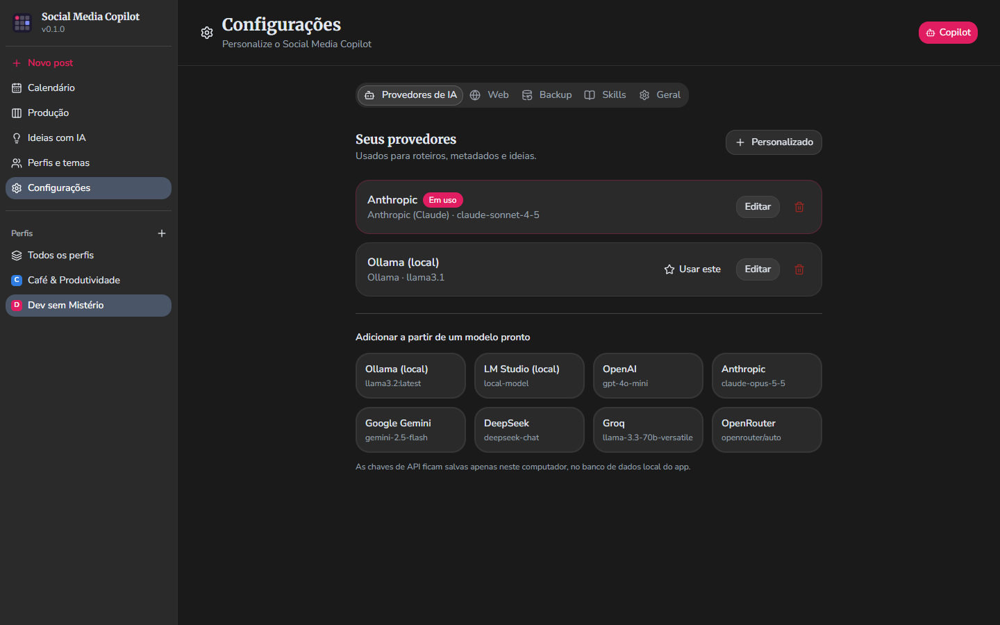

### 📚 Skills: métodos que a IA segue

As skills são guias de método que o Copiloto aplica sozinho: roteiros de YouTube longo, Shorts (método GPC: Gancho, Progresso, Clímax), legendas, carrosséis, hashtags e planos de conteúdo para o Instagram. Você pode ler e ligar ou desligar cada uma.

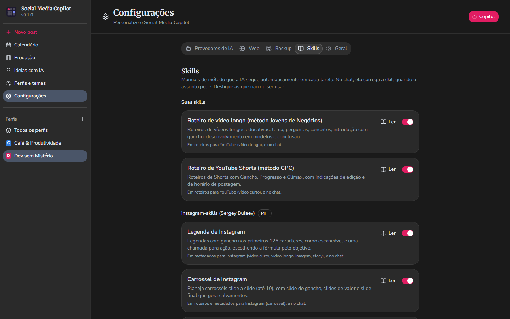

### 🔒 Seus dados, no seu computador

Tudo fica num banco de dados local. Não existe conta, login nem servidor do Social Media Copilot. Você pode **exportar um backup** e **restaurá-lo** depois, inclusive em outro computador.

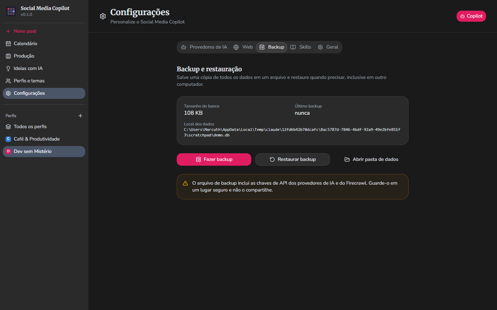

### 🎨 Tema claro e escuro

Escolha entre claro, escuro ou o mesmo do seu sistema.

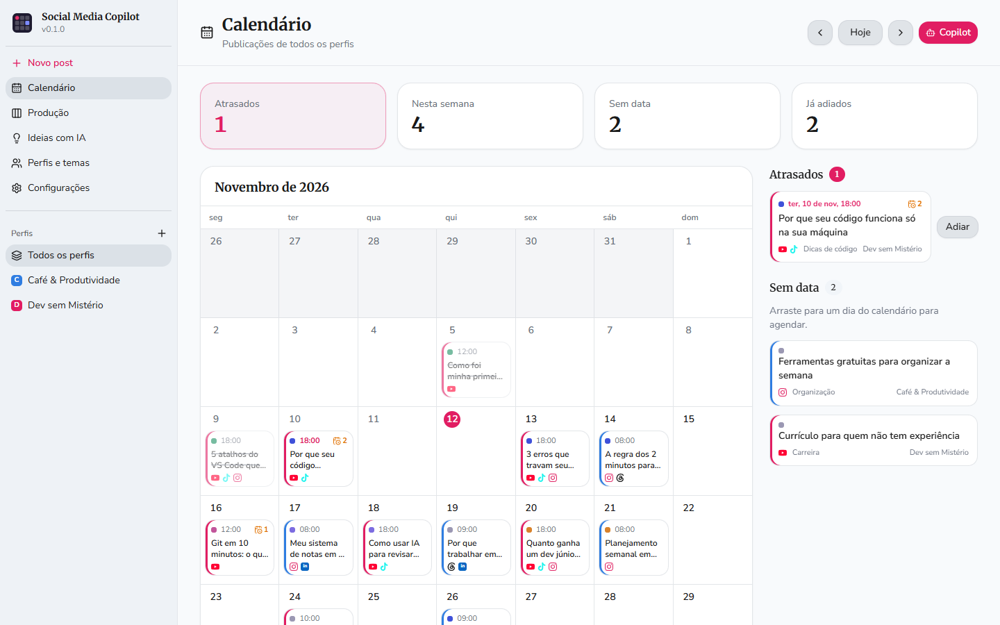

---

## 🚀 Primeiros passos

### 1. Instalar

Baixe o arquivo mais recente na página de [**Releases**](https://github.com/marcuth/social-media-copilot/releases):

| Sistema     | Arquivo                                                  |
| ----------- | -------------------------------------------------------- |
| **Windows** | `...-windows-amd64-setup.exe` (instalador) ou o `.exe` portátil |
| **Linux**   | `.AppImage` (portátil) ou `.deb`                         |

> Prefere compilar você mesmo? Veja [Para desenvolvedores](#-para-desenvolvedores).

### 2. Configurar a IA

Abra **Configurações > Provedores de IA**, escolha um modelo pronto (ou crie um personalizado) e informe:

| Campo            | O que colocar                                                                                        |
| ---------------- | ---------------------------------------------------------------------------------------------------- |
| **Chave de API** | A chave gerada no site do provedor (modelos locais, como o Ollama, normalmente não exigem)           |
| **Modelo**       | O nome do modelo que você quer usar (ex.: `gpt-4o-mini`, `llama3.2`)                                 |
| **URL base**     | Só para provedores compatíveis com OpenAI ou locais (ex.: `http://localhost:11434` para o Ollama)    |

### 3. Criar seu primeiro perfil

Em **Perfis e temas**, crie um perfil, marque as plataformas em que ele publica e descreva nicho, público e tom de voz. Depois clique em **Novo post** e peça um roteiro ao Copiloto.

### Dica de fluxo

1. Capture as ideias em **Ideias com IA** ou direto como posts na etapa _Ideia_.
2. Gere o roteiro e os metadados no editor e ajuste do seu jeito.
3. Marque a data e acompanhe pelo calendário e pelo quadro de produção.
4. Ao publicar, marque cada plataforma como publicada e guarde o link.

---

## ❓ Perguntas frequentes

**O app publica os posts por mim?**
Não. Ele organiza e ajuda a produzir o conteúdo. Você publica em cada rede e marca no app o que já saiu, com o link.

**Meus dados são enviados para algum lugar?**
Seus perfis, posts e agenda ficam só no seu computador. Quando você usa o Copiloto, o contexto necessário e a sua mensagem vão ao provedor de IA que você configurou, e a política de privacidade dele passa a valer. Para que nada saia do computador, use um modelo local (Ollama, LM Studio). Se ligar a pesquisa na web, as buscas e os links lidos passam pelo provedor ou pelo Firecrawl.

**Preciso pagar alguma coisa?**
O app é gratuito e open source. Provedores de IA na nuvem podem cobrar pelo uso da API, e modelos locais são gratuitos.

**Onde ficam guardadas as minhas chaves de API?**
No banco de dados local, em texto simples, no seu computador. O backup também inclui as chaves, então guarde o arquivo com cuidado e evite usar o app em computadores compartilhados.

**O app funciona sem internet?**
Sim, com um modelo local. O calendário, o quadro e o editor não dependem de internet.

**Como levo meus dados para outro computador?**
Em **Configurações > Backup**, exporte um arquivo e restaure-o no outro computador. Antes de restaurar, o app guarda uma cópia do estado atual. Atenção: restaurar substitui os dados atuais.

**Onde fica o banco de dados?**
Em `%APPDATA%\social-media-copilot` no Windows e em `~/.config/social-media-copilot` no Linux.

**A IA escreveu algo errado.**
Ela é uma ajudante, não uma fonte de verdade. Revise fatos, números e promessas antes de publicar.

---

## 🧑‍💻 Para desenvolvedores

Stack: [Wails v3](https://v3.wails.io) (Go) + Vue 3 + TypeScript + Vite + Tailwind CSS 4 + shadcn-vue, com SQLite local (sem CGO) e [GoAI](https://github.com/zendev-sh/goai) para falar com os provedores.

**Pré-requisitos:** Go 1.26+, Node 20+ e o CLI do Wails.

```bash
go install github.com/wailsapp/wails/v3/cmd/wails3@v3.1.0

wails3 dev      # app com hot reload
wails3 build    # gera bin/social-media-copilot(.exe)
wails3 package  # instalador (Windows: NSIS; Linux: AppImage, deb, rpm)
go test ./...   # testes do backend
```

Para usar outro banco (por exemplo, para testes), defina `SMC_DB_PATH`. As releases são geradas pelo workflow `.github/workflows/release.yml` quando uma release é publicada.

Detalhes de arquitetura e convenções em [`CLAUDE.md`](./CLAUDE.md).

## 📄 Licença

[MIT](./LICENSE) © [Marcuth](https://marcuth.dev)

As skills de Instagram vêm de [sergebulaev/instagram-skills](https://github.com/sergebulaev/instagram-skills) (MIT, © Sergey Bulaev).

---

<div align="center">

Feito com ❤️ por Marcuth.

</div>
